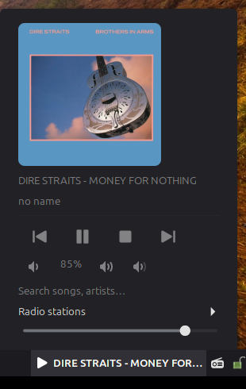
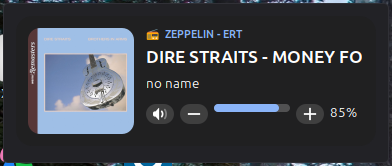

# Volumio Remote for Cinnamon

Control a [Volumio](https://volumio.com) player on your network from the Linux Mint
Cinnamon desktop. Two independent parts:

| | What it is | UUID |
|---|---|---|
| **Applet** | Panel (taskbar) icon with a popup: art, title/artist, transport, volume, song search, web radio list | `volumio@amystikis` |
| **Desklet** | Desktop "now playing" card: art, station, scrolling title/artist, volume. Shape and colours adjustable | `volumio-desklet@amystikis` |




## Install

```bash
git clone https://github.com/amystikis/cinnamon-volumio-remote.git
cd cinnamon-volumio-remote
./install.sh            # both;  or  ./install.sh applet  /  ./install.sh desklet
```

Then add *Volumio Remote* from **Applets** and/or **Desklets**, open its settings and
enter your Volumio's IP address or host name. If it is not listed, restart Cinnamon
(Ctrl+Alt+Esc) or log out and back in.

## Artwork

Volumio often has no cover for web radio. In that case the cover is looked up from the
artist and song, with strict matching so a wrong cover is rejected. If the artist is
empty or "no name", the song title alone is used (and "Artist - Song" titles are split).
Choose the source in the settings:

- **MusicBrainz / Cover Art Archive first, iTunes as backup** (default)
- MusicBrainz / Cover Art Archive only (open data, no commercial service)
- iTunes only
- Don't look up artwork

## Requirements

- Volumio reachable on your network (its REST API, port 80)
- `curl` (installed by default on Linux Mint)

## Submitting to Cinnamon Spices

`applets/<uuid>/` and `desklets/<uuid>/` are laid out exactly as the
[cinnamon-spices-applets](https://github.com/linuxmint/cinnamon-spices-applets) and
[cinnamon-spices-desklets](https://github.com/linuxmint/cinnamon-spices-desklets)
repositories expect, so each folder can be copied into a fork unchanged.

## License

GPL-3.0, see [LICENSE](LICENSE). Copyright (C) 2026 amystikis.
